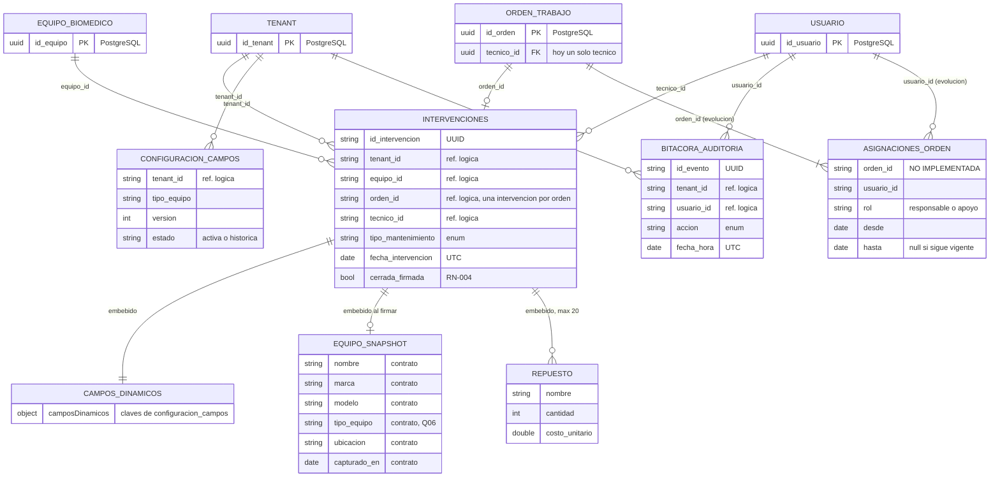

# Modelo Documental, Decisiones y Contrato de Datos de MongoDB - SITBIO

Prueba conceptual de la guía NoSQL semana 2 (modelado) aplicada a SITBIO. Los nombres de campos son los del script `database/02_MongoDB_SITBIO.js`; los campos que el validador no declara y que se garantizan por contrato (API y semilla) se marcan como **contrato**. El script 02 no se modifica (ADR-005).

Documentos relacionados: `01_patrones_acceso.md` (Q01–Q06, W01–W04), `02_decisiones_diseno.md` (embebido, referencias y snapshot) y `03_diccionario_datos_e_integridad.md`.

## 1. Diagrama del modelo

Lectura de las relaciones (el lado con `o` admite cero; el lado con `|` exige al menos uno):

| Relación | Tipo | Cardinalidad | Sentido de la referencia |
|---|---|---|---|
| Intervención → `camposDinamicos` | 1:1 embebido | exactamente 1 (puede ser `{}`) | dentro del documento |
| Intervención → `equipo_snapshot` | 1:1 embebido | 0..1 (null hasta firmar) | dentro del documento |
| Intervención → `repuestos[]` | 1:N embebido acotado | 0..20 | dentro del documento |
| Equipo → intervenciones | 1:N referenciado | un equipo tiene 0..N intervenciones; cada intervención, exactamente 1 equipo | `intervenciones.equipo_id` → `equipo_biomedico.id_equipo` |
| Tenant → configuraciones | 1:N referenciado | un tenant tiene 0..N versiones; cada versión, exactamente 1 tenant | `configuracion_campos.tenant_id` → `tenant.id_tenant` |
| Orden → intervención | 1:1 lógico | una orden tiene 0..1 intervención; cada intervención, exactamente 1 orden | `intervenciones.orden_id` → `orden_trabajo.id_orden` |
| Técnico → intervenciones | 1:N referenciado | 0..N | `intervenciones.tecnico_id` → `usuario.id_usuario` |
| Técnicos ↔ órdenes | N:M (evolución, **no se implementa**) | una orden con 1..N técnicos; un técnico en 0..N órdenes | colección de vínculo `asignaciones_orden` con `rol`, `desde` y `hasta` |

**Conceptos.**

- **Embeber** es guardar un subdocumento dentro del documento padre. Conviene cuando ambos comparten ciclo de vida, se leen juntos y el tamaño está acotado (`camposDinamicos`, `equipo_snapshot`, `repuestos`).
- **Referenciar** es guardar solo el identificador del otro registro. Conviene cuando el lado «muchos» crece sin límite o tiene vida propia (el equipo vive en PostgreSQL y acumula intervenciones durante años).
- **Referencia lógica:** MongoDB no tiene claves foráneas, y menos hacia PostgreSQL. El identificador se guarda como texto UUID y la API comprueba que exista (sección 5).
- **N:M con colección de vínculo:** hoy `orden_trabajo.tecnico_id` admite un solo técnico. Si una orden tuviera varios, el vínculo tendría atributos propios (rol y vigencia), y por eso iría en su propia colección (`asignaciones_orden`) y no como arreglos cruzados en órdenes y usuarios, que habría que mantener sincronizados.

## 2. Decisiones

### Decisión A. El historial de intervenciones va en una colección propia

| Aspecto | Contenido |
|---|---|
| Necesidad | Q02 (línea de tiempo de un equipo), Q03 (detalle por orden) y Q04 (extracción por rango de fechas) leen intervenciones; W02 inserta una por cada orden cerrada. |
| Alternativas | (1) Arreglo `intervenciones[]` dentro de un documento por equipo. (2) Colección `intervenciones` con `equipo_id` como referencia. |
| Elección | Alternativa 2. Q02 se resuelve con el índice `IDX_003_intervenciones_tenant_equipo` (`tenant_id`, `equipo_id`, `fecha_intervencion` descendente) y paginación. |
| Límite | Un documento BSON no puede pasar de **16 MiB**. Con intervenciones de 2–5 KB (diagnóstico, repuestos y campos dinámicos), un equipo con mantenimientos mensuales durante 15 años acumula cientos; además, un arreglo que crece obliga a reescribir el documento y su índice en cada inserción. |
| Regla de actualización | W02 inserta un documento nuevo; nunca se agrega a un arreglo. Antes de firmar, la intervención se puede corregir; después, no (RN-004). |
| Costo | Q02 necesita un índice y una consulta en lugar de leer un solo documento. |
| Cuándo revisarla | Si apareciera una consulta que necesite el equipo y todo su historial en una sola lectura, se evaluaría un resumen embebido acotado (por ejemplo, las últimas 5 intervenciones) además de la colección. |

### Decisión B. `equipo_snapshot` se captura al cerrar y firmar la orden (HU-021)

| Aspecto | Contenido |
|---|---|
| Necesidad | Q06 (costos históricos por tipo de equipo) y los reportes deben mostrar el equipo como era al intervenirlo, aunque después cambie de nombre o de ubicación. La hoja de vida (UI-006) muestra el dato **actual** desde PostgreSQL. |
| Alternativas | (1) Capturar el snapshot al crear la orden. (2) Capturarlo al cerrar y firmar. (3) No guardar snapshot y consultar siempre PostgreSQL. |
| Elección | Alternativa 2. Campos: `nombre`, `marca`, `modelo`, `tipo_equipo`, `ubicacion` y `capturado_en`. Se incluye `tipo_equipo` porque Q06 agrupa por `equipo_snapshot.tipo_equipo`. |
| Por qué al firmar | Firmar es el momento en que la intervención se vuelve inalterable (RN-004). Si se capturara al crear la orden, un traslado durante la ejecución quedaría mal registrado; si no hubiera snapshot (alternativa 3), los reportes históricos cambiarían cada vez que se edita el equipo. |
| Límite | Subdocumento de tamaño fijo (6 campos, menos de 1 KB). |
| Regla de actualización | Se escribe **una sola vez** en W03, en la misma actualización que pone `cerrada_firmada: true`, con el filtro `{ tenant_id, id_intervencion, cerrada_firmada: false }`. Después no se vuelve a escribir. |
| Costo | Datos duplicados entre PostgreSQL y MongoDB. Es intencional: es una copia histórica, no un dato que se sincroniza. |
| Cuándo revisarla | Si un reporte necesitara otro atributo histórico del equipo (por ejemplo, la criticidad al intervenir), se agrega al snapshot de las intervenciones nuevas; las ya firmadas no se completan. |

### Decisión C. Máximo 20 elementos en `repuestos`

| Aspecto | Contenido |
|---|---|
| Necesidad | W02 registra los repuestos usados; Q04 y Q06 suman `costo_total`. |
| Alternativas | (1) Arreglo embebido sin límite. (2) Arreglo embebido con un máximo. (3) Colección aparte `repuestos_intervencion`. |
| Elección | Alternativa 2, con un máximo de **20** elementos. Los repuestos solo existen dentro de su intervención y se leen con ella; un arreglo acotado no tiene el riesgo de crecer sin fin. |
| Límite | 20 × unos 200 bytes ≈ 4 KB por intervención. El validador del script 02 no declara `maxItems`; el límite es un **contrato** que validan la API (400 con error en `repuestos`) y la semilla. |
| Regla de actualización | Se reemplaza el arreglo completo mientras la intervención no esté firmada; después, no se modifica (RN-004). |
| Costo | Una intervención con más de 20 repuestos distintos tendría que agruparlos (por ejemplo, «kit de mantenimiento preventivo»). |
| Cuándo revisarla | Si los datos reales muestran intervenciones que superan 20 repuestos distintos, o si se necesita consultar el consumo de un repuesto entre muchas intervenciones; en ese caso, la alternativa 3. |

## 3. Contrato null / ausente

En MongoDB un campo puede tener un valor, valer `null` o no existir. El filtro `{ campo: null }` devuelve **tanto** los documentos con `null` como los que no tienen el campo; `{ campo: { $exists: false } }` solo los que no lo tienen, y `{ campo: { $type: "null" } }` solo los que valen `null`. Para que las consultas sean predecibles, el contrato fija qué campos existen siempre:

| Campo | ¿Siempre presente? | ¿Admite null? | Valor según el estado de la orden | Cómo se consulta |
|---|---|---|---|---|
| `equipo_snapshot` | Sí | Sí, mientras la orden no esté firmada | `null` hasta firmar; objeto completo desde la firma | Intervenciones firmadas: `{ cerrada_firmada: true }` |
| `cerrada_firmada` | Sí | No | `false` al crear; `true` al firmar | `{ cerrada_firmada: false }` para las editables |
| `camposDinamicos` | Sí | No | `{}` si el tipo de equipo no tiene campos configurados | `{ "camposDinamicos.<clave>": { $exists: true } }` |
| `repuestos` | Sí | No | `[]` si no se usaron | `{ repuestos: { $size: 0 } }` |
| `costo_total` | Sí | No | `0` si no hubo costo | rangos con `$gte` y `$lt` |

## 4. Integridad y eliminación

| Operación | Política | Responsable |
|---|---|---|
| Crear intervención (W02) | Antes de insertar, la API comprueba en PostgreSQL que el equipo y la orden existan **en el tenant del token** y que la orden esté asignada al técnico. `tenant_id` sale del JWT, nunca del cuerpo (RN-008). | API (caso de uso de HU-006) |
| Modificar intervención firmada | Se rechaza con 409 y código `RN-004`. Toda actualización filtra por `cerrada_firmada: false`, así que una firmada nunca coincide. | API + filtro del repositorio |
| Borrar intervención | Nunca. No hay borrado físico ni lógico; el repositorio base no ofrece eliminación. | API (`RepositorioMongoTenant` sin método de borrado) |
| Equipo dado de baja (HU-014) | Se conservan todas sus intervenciones; la baja en PostgreSQL es lógica y el snapshot conserva el contexto histórico. | API + PostgreSQL |
| Referencia rota detectada (por ejemplo, `equipo_id` que no existe) | Se registra un evento en `bitacora_auditoria` y se repara con trazabilidad (quién, cuándo y valor anterior); nunca se borra el documento. | Proceso de verificación de la semilla (L2) y administrador del proveedor |
